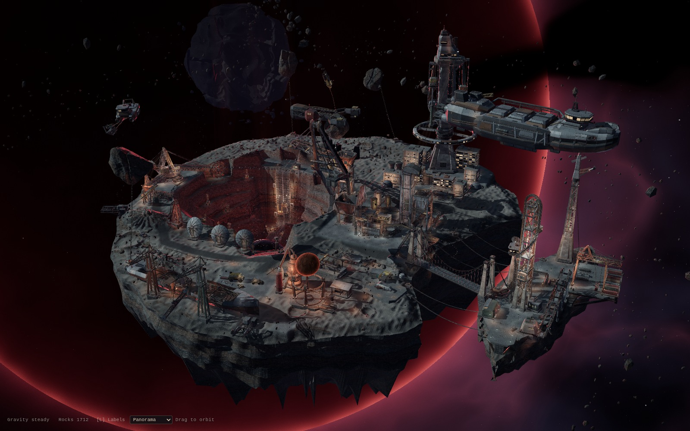

# The Lode

A deep-space mine built around a black, glassy mass at the bottom of an open pit. Start at the excavator on the left and follow one stone. It arcs across the pit, falls upward through a shaft, crosses a suspension bridge in a rail wagon, then flies from the top of a tower into a freighter. Watch the same trajectory when the red gravity tide arrives.

[Open The Lode in your browser](https://ashstarry.github.io/the-lode/)



## Enter the mine

The browser entry point is [web/index.html](web/index.html). To run the complete mine offline, extract the project and run this command from the directory containing this README.

```sh
python3 tools/serve.py
```

Open [the local mine](http://127.0.0.1:8137/). On Windows, use `py -3 tools/serve.py`. The server listens on `127.0.0.1`, serves byte ranges for films and sends `Cache-Control: no-store`. Stop it with `Ctrl+C`. Three.js r186, the models, height field, textures and recordings ship with the project. Python 3 and a browser are sufficient for viewing.

WebGL 2 with half-float rendering runs the live simulation. A software renderer or a browser with limited graphics support opens the recorded tour. **Live 3D** opens the simulation on a compatible device. The tour has 60 landscape orbit angles and 24 portrait angles, close-ups and footage captured in the same simulation.

### Controls and opening shot

- Drag to orbit. Scroll or pinch to zoom. Right-drag or pan with two fingers to move the target. Pointer input pauses automatic orbit for 45 seconds.
- Press **L** or tap **Labels** to show field notes. **Rocks** counts free, sleeping and carried grains. The debris ring and loose surface stones have separate counts.
- Use the viewpoint menu for Tower Watch, Crane Catwalk, Work Barge, Salvage Beam, Bench Collapse, Cargo Hold, Axle Shop, Habitat and Dark Star. Changing viewpoints keeps the current shift running. A direct link to a close-up can start at a time chosen for that operation.
- The recorded tour supports touch, zoom, arrow keys, labels and playback controls. Its opening runs for 18 seconds, then continues into a 24-second recording of the same shift in calm conditions.

The first frame is a high-resolution photograph from the live camera at 20.0 seconds. Five aspect ratios cover the opening composition. The loading bar follows model loading and parsing, texture decoding and upload, fixed-step warm-up and shader compilation. The photograph fades over 0.38 seconds once the GPU finishes the first frame at its target resolution. Reduced-motion mode uses an immediate handover. Gestures during loading carry through to the camera. The first gravity tide starts 0.8 simulated seconds after handover. On high-density phones the opening resolution targets up to 2×, within a budget of about 1.25 megapixels.

## Camera and lighting

The landscape camera is at `(327,370,685)` in Three.js coordinates, looking at `(34,4,6)` with a 31.2° vertical field of view. The portrait camera moves to `(357,351,668)` and looks at `(30,11,3)`. A disused haul cut on the southeast rim opens a sightline to the black crown. The low salvage yard and foundry occupy the south rim. The listening dishes lean into the pit. The bridge towers leave a clear path for ore flying into the freighter.

The habitat tower reaches 179.82 m with a 44 m shoulder. The crane’s inclined frame rises to 118.41 m. Crews of three occupy the two upper platforms and the axle shop. Their figures, the 1.1 m handrails, access doors and winches provide a common scale. The cargo hold has fairleads and recessed maintenance galleries. The habitat ring has pressure passages and exposed bearings.

The dark star supplies the crimson rim light. Its sky is baked to a 256-pixel cubemap and filtered with PMREM so steel, glass and the Lode reflect it. A patch of dust obscures about ten degrees of the star’s right limb, its corona and the stars behind it. The broken moon has displaced strata and eroded impact craters. A faint fill reveals the cold side of the debris ring. The 960 orbiting rocks include 68 large fragments, leaving open space for the work barge and its suspended drum.

Local lamps feed a 1024² half-float irradiance map. Exposure is 1.32 and bloom strength is 0.34. Windows and beacons vary smoothly. The red tide front advances at 30 m/s on the same clock as the gravity reversal. Work lights dim as the front reaches their positions, then recover in sequence. The tower crowns and distant freighter hold their silhouettes as the searchlights turn toward the pit.

## URL parameters

Parameters can be combined, for example `?ff=150&rot=0&tags=1`. The top-level static entry preserves both the query string and fragment when opening `web/`.

| Parameter | Effect |
| --- | --- |
| `ff=45` | Set the opening simulation time in seconds, from 0 to 3600. The default panorama starts at 20.0. Use `ff=480` for the eight-minute run. |
| `tags=1`, `tags=0` | Show or hide attached labels. Labels start hidden. |
| `view=tour`, `view=live` | Open the recorded tour or request live WebGL. |
| `rot=0` | Stop automatic orbit. Manual orbit stays available. |
| `dpr=1` | Override render pixel ratio. The normal desktop ceiling is 1.5. Phones use the pixel budget described above. |
| `cam=x,y,z`, `tgt=x,y,z` | Set camera and target in Three.js coordinates. |
| `focus=salvage`, `face`, `hull`, `yard`, `hab`, `sky`, `watch`, `mast`, `harbor` | Start at a named viewpoint. An explicit `ff` overrides its suggested time. |
| `bloom=0` | Disable bloom. Grading and output continue. |
| `parts=terrain,habitat` | Load the listed parts. Systems can use default markers and simplified geometry during modeling. |
| `test=pile`, `funnel`, `rigid`, `rope`, `bridge` | Run the grain pile, hopper, rigid-body, suspended-load or asymmetric bridge-load sandbox. |
| `manual=1` | Pause automatic stepping after warm-up for repeatable inspection. |
| `shadow=2048` | Set the main light’s shadow-map resolution. The normal scene uses 4096. |

Local examples include the [eight-minute shift](http://127.0.0.1:8137/?ff=480&rot=0), [site plan](http://127.0.0.1:8137/?tags=1&rot=0&cam=5,692,0.01&tgt=5,-18,0), [hopper](http://127.0.0.1:8137/?test=funnel&ff=10) and [bridge load](http://127.0.0.1:8137/?test=bridge&ff=8).

## Source and assets

| Path | Contents |
| --- | --- |
| `blender/lib/layout.py` | Shared metric plan for roads, aprons, pit and railways. Blender uses east +X, north +Y and up +Z. Three.js maps these to (x, z, −y). |
| `blender/lib/terrain.py`, `ground.py` | 2048² terrain generation, exposed strata, rock roots and height lookup. |
| `blender/lib/kit.py`, `blender/GUIDE.md` | Hard-surface primitives, metric UVs, material families, pivots, lamps and colliders. |
| `blender/parts/` | Editable generators for the excavator, plant, habitat, fleet, cut asteroids, salvage yard and crews. |
| `web/assets/` | Ten site GLBs, one work-crew GLB, scene metadata, a 1024² height field, seven procedural textures, opening plates and recorded media. |
| `web/vendor/three/` | Three.js 0.186.0, the addons used here and their MIT license. |
| `web/src/main.js`, `post.js` | Loading, cameras, fixed-step loop, warm-up, grading and output. |
| `web/src/materials.js`, `lights.js`, `sky.js` | Weathering, light-map projection, procedural sky and environment reflections. |
| `web/src/physics/` | Gravity fields, PBD grains, compound rigid bodies, XPBD distance constraints and sandboxes. |
| `web/src/systems/` | Production, rolling stock, freight, bridge, tug and breaker, tide, debris ring, foundry, crews and yard operations. |
| `tools/`, `qa/` | Local server, capture and test scripts, site photographs and measurement reports. |

### Rebuild a model

Blender 4.3.2 with its bundled NumPy was used for the exports. After changing the site plan or ground height, rebuild the parts that sit on that ground. On macOS the executable may be `/Applications/Blender.app/Contents/MacOS/Blender`.

```sh
blender -b --offline-mode --factory-startup --python-exit-code 1 --python blender/build.py -- plant
blender -b --offline-mode --factory-startup --python-exit-code 1 --python blender/build.py -- all
blender -b --offline-mode --factory-startup --python-exit-code 1 --python blender/preview.py -- plant
```

The standalone project history includes tags `m1` through `m17`. The first eight cover the pipeline, solvers, models, production line, lighting, large-scale effects, site dressing and acceptance. `m9`–`m12` cover detailed models, salvage and rockfall, camera views, solver revisions and measurements. `m13` adds the taller towers, crews and work barge. `m14` adds responsive framing and the tour. `m15` records the single red front, dark dust and opening films. `m16` adds the measured loading bar and full-resolution handover. `m17` is the English release. In the offline archive these tags belong to the enclosed project. The Pages host has its own commit history.

Use `git log --oneline --decorate` in the standalone checkout. An older milestone can be opened in a separate worktree and its assets regenerated there.

```sh
git worktree add ../lode-m1 m1
cd ../lode-m1
blender -b --offline-mode --factory-startup --python-exit-code 1 --python blender/build.py -- textures terrain habitat
python3 tools/serve.py --port 8138
```

## What the simulation solves

The fixed step is 1/60 s with three substeps for grains, rigid bodies and ropes. The renderer catches up by at most three fixed steps per frame. Warm-up uses the same step function, including particle ages, fire control, cargo ownership, crane work and tides. Some machinery and one train start with material aboard. Reported production counters accumulate from zero.

| System | Integrated or solved | Authored constraints and approximations |
| --- | --- | --- |
| Grains, hoppers and stockpiles | Pre-stabilized PBD contacts, Coulomb friction, rebound, sleep and support checks. A 2 m spatial hash limits contact candidates. | Grains are spheres. The crusher holds an inventory count and emits fresh grains. |
| Gravity and tides | Free grains and loads sample the local field. The plate pulls only above ground. The Lode exerts a core-limited `k/r` pull plus swirl. | A state machine sets the tide envelope, front and reversal band. The habitat, gravity wall and repulsion dome use specified fields. |
| Excavator, Sling and belts | The rotor coasts under backpressure. Fire control integrates trial shots in the current field and adjusts speed and azimuth with a two-variable Newton iteration. Airborne ore responds to later tides. | Belt surface speeds, friction and bounded guides steer material. Handoffs occur at machine interfaces. Spills time out. |
| Pulse jig, Updraft and surge bin | Waste responds more strongly to each upstroke. Feed plates and a skimming field separate it. An upward centering force drives grains in the shaft. Grains make contact in the bin. | Guides handle capture, bends and long transfers. Capacity limits propagate upstream. |
| Ore vortex and gravity seeps | Vertical, radial and tangential accelerations form the ore column. Seep stones leave their lift field and arc toward the Lode. | The take-up point replenishes material. A field guides it along the jib. Older captured rock dissipates when the halo fills. |
| Moored boulders, tug and breaker | Compound rigid bodies accumulate forces, torque and contacts. Tension-only XPBD cables and chains limit extension. Tug thrust is bounded. | Rocks use one to three contact spheres. A capture field helps final docking. Precut Voronoi asteroids separate into 32 or 33 pieces, with mass-weighted velocities corrected for total momentum. |
| Trains, haul trucks and freighters | Tractive acceleration and braking depend on load. The suspension pitches. Ore slides from the tipper and inherits wagon velocity at the Whip. | Vehicles follow surveyed paths. Cargo rides locked to its carrier. Arriving and departing freighters follow controlled flight paths. |
| Bridge and dock crane | Two edge chains, main cables and hangers form a 24-section XPBD deck. Asymmetric load twists and deflects it. Two lines constrain the crane spreader and its offset load. | Fastener stiffness is represented by an effective value. Guides seat a container and lock it down. |
| Debris ring and loose stones | All 960 ring rocks are integrated separately with radial damping and a nominal circular speed of √70 ≈ 8.37 m/s. The advancing front launches up to 360 loose surface stones into ballistic flight and rebound. | Ring rocks pass through each other. The 90 fragments streaming from the broken moon follow quadratic Bézier paths. Dust is rendered as particles. |
| Molten metal | The center, incoming and draining drops, and ten forced damped oscillators are integrated. Incoming metal adds volume and the drain has its own counter. | Second-, third- and fourth-order surface modes plus tidal stretch approximate the liquid surface. |
| Salvage handoff | After release, the beam follows local gravity. Geometry sets its principal moments. Quaternion midpoint integration at conserved world angular momentum gives an intermediate-axis flip. | The winches control spin-up, hook engagement, braking and paid-out cable. Trial releases calibrate the launch. |
| Bench collapse | Excavation accumulates damage and neighboring slabs exchange stress. Tides weaken support. Detached slabs accelerate, slide, roll and collide. | The working face has 21 precut slabs. Ground support uses oriented ellipsoids and inter-slab contacts use spheres. Freshly exposed strata reset the face for another pass. |
| Tower counterweights | Two rail-mounted masses respond to springs, damping, a shared hydraulic circuit and asymmetric tidal loads. Drums and cables follow their displacement. | The applied support load is prescribed. The tower frame is rigid. |
| Work barge and cargo handling | Thrust-limited flight and twin cables give the barge and its offset drum mutual forces, roll and overshoot. The freighter responds to tides, control thrust and cargo impulses. | Waypoints and loading commands are authored. Distant ship changes follow approach and departure trajectories. |
| Lighting, crews and searchlights | The light front uses the same position, speed and strength as the physical tide. Survey drones correct overshoot with limited thrust. | Local lamps share an overhead irradiance map without individual shadows. Mist, the passing shadow and searchlight shafts are artistic effects. Workers walk or bound on fixed routes. |

## Inspect a running shift

In live mode, `window.__mine` exposes the scene, renderer, controls, uniforms, layout, objects, lights, simulation and systems. `find(part,name)` returns an object at its named pivot. `mark(part,name)` returns a marker in Three.js coordinates.

```js
const a = window.__mine;
console.table(a.sim.history);
console.table({
  launched: a.sys.ore.launched,
  caught: a.sys.ore.caught,
  raised: a.sys.ore.raised,
  trainLoaded: a.sys.rail.loaded,
  shipReceived: a.sys.freighter.received,
  shipDepartures: a.sys.freighter.departures,
  fragmentsGround: a.sys.breaker.ground,
  beamTransfers: a.sys.salvage.transfers,
  freeFlips: a.sys.salvage.flips,
  benchCascades: a.sys.rockfall.cascades,
  bridgePeakMetres: a.sys.bridge.peak,
  drains: a.sys.crucible.drains
});
```

At `?manual=1&ff=45&rot=0`, issue `a.sys.tides.trigger(1.85)`, `a.step(201)`, `a.draw()` and `a.updateHUD()` to inspect a tide at a fixed camera position. `a.holdTide=true` holds the current tide state. A failed GPU shader shows **SHADER ERROR** and retains its log in `a.fatal`.

The browser tools use Python Playwright. Set `LODE_CHROME` to a Chromium executable, or `LODE_SW=1` to request software rendering. Each command below runs a local server. Stop any server using the same port first.

```sh
python3 tools/verify.py --url '?ff=480&manual=1&rot=0&dpr=1.5' --script tools/soak.js --bench --shot ''
python3 tools/verify.py --url '?ff=45&manual=1&rot=0&dpr=1&shadow=2048' --script tools/stability.js --shot ''
python3 tools/captures.py
python3 tools/films.py
python3 tools/startup_check.py --output /tmp/mine-startup
```

The 120-frame stability check fixes the camera and tide while production, people, spotlights, metal and debris continue moving. It reads the entire graded frame and compares a 16×10 grid across time. Separate scans cover the raw HDR scene before bloom sanitation and the local light map in calm and strong tides. Browser errors and shader failures are recorded. The test filters Chromium’s performance notices for intentional synchronous readback.

## Recorded measurements

| Inspection | Result |
| --- | --- |
| Opening composition | The crown, main tower, freighter and jib are visible at 1600×1000 and 390×844. All 52 sampled grains on the sling trajectory are visible in each view. |
| Dark star and dust | At 20 s, dust obscures or softens about 10.1° of the limb. About 93.0% of the limb retains at least 98% transmission. |
| Tide and lamps | Nine comparisons at 960×600 isolate the lighting change. At 25.3 s, 26,551 pixels gain red above the test threshold. Lamp-map energy 12–45 m behind the front falls to 30% of baseline. It stays at 100% beyond 55 m ahead. |
| First shift | The panorama opens at 20.0 s, the first tide begins at 20.8 s and the freighter catches its first rock around 32.25 s. The 18 s opening film leads into the 38–62 s production recording. |
| Ore at 480 s | 1,882 launched, 1,627 caught, 2,343 fed through the jig, 1,091 raised in the shaft, 1,052 binned and 734 discarded. |
| Shipping | Trains loaded 505 grains and released 518 at the tower. The freighter received 361 and completed one changeover. Peak bridge deflection reached 0.193 m. |
| Events | Seven tides, 2,006 surface-stone launches, six asteroid breaks, one molten drain and six barge transfers. |
| Grain pool at 480 s | 2,550 total, comprising 1,250 free, 1,134 sleeping and 166 carried. |
| Temporal stability | At 1600×1000, DPR 1 and 4× MSAA, mean-luminance standard deviation was 0.0000445. The largest adjacent-frame block difference was 0.00293. No whole block flashed. Raw HDR, light map and graded output were finite in both tide states. |
| Performance | On ANGLE SwiftShader, 720 steps after warm-up averaged 7.24 ms of main-thread CPU, with a 9.50 ms P95. The 5 ms budget remains open. The 25 fps laptop-GPU target needs a hardware measurement. |

[Acceptance data](qa/acceptance.json) · [Sightline measurements](qa/sightlines.json) · [Opening-film validation](qa/opening-validation.json) · [Opening tide](qa/16-browser-tide.jpg) · [Loading screen](qa/17-loading.jpg) · [Cold-start measurements](qa/startup.json)

Use `tools/pressure.js` with `tools/verify.py` at `?ff=20&rot=0&manual=1` for paired readbacks of the tide illumination. The tools compare the lamp map and output pixels at the same pose and time with and without the effect.

To regenerate media, use a WebGL 2 browser, Playwright and FFmpeg. `tools/plates.py` photographs five high-resolution opening plates. `tools/opening.py` captures both opening-film aspect ratios. Add `--shot shift` for the follow-on shift or `--shot mast-watch` for the crane. `tools/bake_tour.py` generates the orbit album and label index, `tools/captures.py` takes 15 site photographs and `tools/films.py` records three operations. The cold-start test holds a texture request to check the progress bar, compares the plate against the rendered frame, and exercises the orbit fallback when opening video is unavailable.
